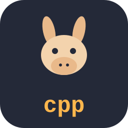
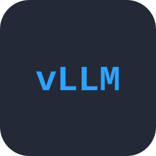
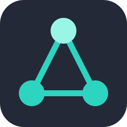
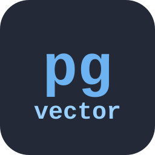
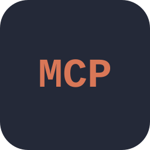
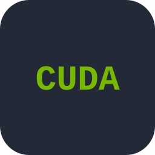
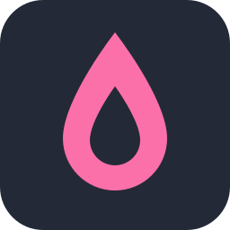

---

## `$ whoami`

Desarrollador de software e inteligencia artificial. Me especializo en plataformas web, automatización de procesos y soluciones basadas en IA: desde agentes y RAG hasta sistemas de gestión con Laravel.

---

## `$ cat tech-stack.yaml`

| `jorge@santiago:~$ cat tech-stack.yaml` | |
| :--- | :--- |
| `├─ ✦ backend:`      `Laravel · PHP · Python · FastAPI` | `├─ ◈ ia_rag:`            `llama.cpp · vLLM · LangChain · LangGraph · Hugging Face · pgvector · MCP` |
| `├─ ▣ datos:`       `PostgreSQL · MariaDB · Redis` | `├─ ⚙ infraestructura:`       `Docker · Ubuntu · NVIDIA · CUDA` |
| `╰─ ◉ frontend:`       `HTML5 · CSS3 · JavaScript · TypeScript · React · Next.js · Vue.js · Livewire · Tailwind CSS · Vite · Astro · Bootstrap` | `seguridad: Argon2`    `status: ready · environment: production` |

---

## `$ ls proyectos/`

**🧠 Plataforma de inteligencia artificial** 
Plataforma orientada al análisis documental, transcripción de audios, extracción de información y automatización mediante agentes especializados. 
`Python` `FastAPI` `LangGraph` `PostgreSQL/pgvector` `Docker`

**🏛️ Sistema interno de administración** 
Sistema desarrollado con Laravel para gestionar, organizar y visualizar audiencias judiciales. 
`Laravel` `MySQL` `Docker`

**🔒 Anonimización de documentos** 
Herramienta local para anonimizar documentos con modelos NER, con editor web y agente de procesamiento. 
`Laravel` `FastAPI` `Transformers`

---

## `$ cat intereses.txt`

- Desarrollo web full stack
- Inteligencia artificial generativa y agentes de IA
- Procesamiento documental
- Fine-tuning y RAG
- Automatización de procesos
- DevOps y contenedores

---

## `$ git log --stats`

---

## `$ connect --socials`

Hecho con 💙 y mucho café desde Santiago, Chile · @yorsh98

